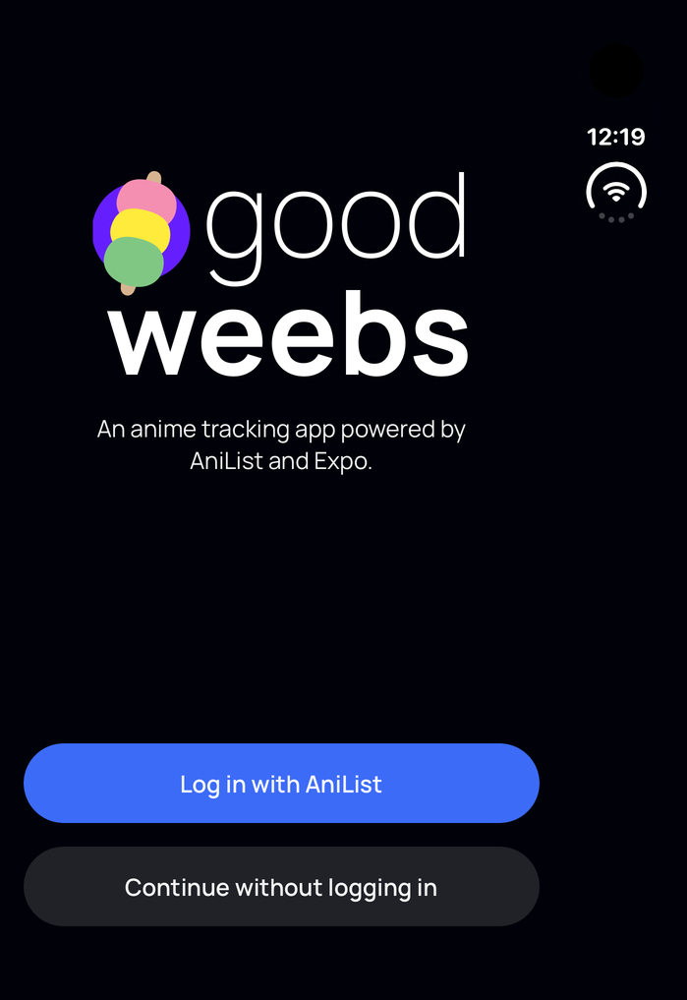

# iPhone Duo and iPad mini support audit

Date: 2026-11-10. Baseline source: `3836499527341151b0f267ff9475df20ae64201a`.

## Status

**Device acceptance is incomplete. These changes are proposals in draft PRs.**

EAS availability returned `{"available":true,"accountName":"fiberjw"}`. Both named Argent sessions reached `IN_PROGRESS`:

- [Initial session](https://expo.dev/accounts/fiberjw/projects/goodweebs/simulator-sessions/01a1c47e-7840-7b90-9219-0d677a9267ff)
- [One clean retry](https://expo.dev/accounts/fiberjw/projects/goodweebs/simulator-sessions/01a1c483-a3cb-74d0-9118-634c4177febc)

Remote `list-devices` reported iPhone Duo on iOS 27.1 and iPad mini A17 Pro on iPadOS 27. The Duo baseline development client installed and fetched the current checkout's bundle from a task-owned Expo tunnel. The mini booted and the baseline app installed, but launching it failed. Do not treat installation as an app UI test.

Argent repeatedly returned this error during launch, inspection, and navigation, including after the clean session reset:

```text
Xcode command-line tools not found — iOS/tvOS simulators need a macOS host with them installed. On macOS, run `xcode-select --install` (or install Xcode from the App Store) and retry.
```

A subsequent Duo confirmation tap failed with HTTP `503`. Native app-scoped inspection and screenshots worked intermittently, so the only captured app state is the Duo welcome screen below. It is **diagnostic baseline evidence only**, not before/after layout evidence. No after screenshot, fold-state comparison, iPad screenshot, or signed-in acceptance was obtained. AniList credentials were not retrieved because its login page was never reached.



Both task sessions were stopped. Task-owned Metro processes were stopped. The pre-existing session configuration was restored; no other session was stopped.

## Recommendations and proposed changes

### 1. Expo-compatible dependencies

Run `npx expo install expo@latest`, `npx expo install --fix`, then a clean frozen Bun install. This upgrades 13 packages, including Expo 58.0.23, Router 58.0.30, and safe-area-context 5.11.1. Add the SQLite config plugin requested by Expo CLI.

`npx expo install --check` reports `Dependencies are up to date`. This means the latest SDK 58-compatible set, not every npm package's latest major. React Native 0.88.1 is current. React 19.3.0, Gesture Handler 3.3, Worklets 0.13.0, and Sentry 8.28 remain Expo's prescribed versions even where npm offers newer releases. LogRocket remains 1.61.2; its 3.16 major migration is outside the compatibility update and still needs separate investigation. The unrelated fbtee major migration is also not included.

Doctor improved from 18/20 to 19/20 after the version fixes and clean install. The remaining directory metadata check reports unmaintained `react-native-render-html` and missing metadata for `@logrocket/react-native`. These warnings are retained, without exclusions. Replacing the HTML renderer is a follow-up proposal requiring separate behavior and spoiler-content testing.

### 2. Available-space layout and Duo safe areas

The source sizes large posters from the whole window divided by three. A Duo rail or native sidebar reduces the actual content width; the three-column assumption also creates oversized posters on a wide display. The proposed fix measures Discover's content view, adds columns as it widens, caps covers at 160 points, and uses the same calculation for placeholders. The grid is remounted only when its column count changes, as required by FlatList. Search/filter state stays in the parent; list scroll position currently resets when the column count changes and should be assessed during device acceptance.

Add horizontal safe areas around tab and pushed-screen content, leaving native bars to the system. Measure HTML descriptions from their own view, rather than the whole window. Keep the same routes, controls, and data in every size.

### 3. iPad mini navigation and rotation

Enable `NativeTabs.sidebarAdaptable` so people can switch between the native tab bar and sidebar. Do not force a sidebar in compact windows. Declare all four iOS orientations for phone and iPad while retaining Android's existing portrait configuration. Prebuild confirmed both iOS orientation arrays contain portrait and landscape values. A fresh client is required; this cannot be verified by Fast Refresh alone.

## Guidance used

- [Apple: Prepare for iPhone Duo](https://developer.apple.com/iphone-duo/prepare/): use view/window geometry, refresh on resizing, avoid device-identity assumptions, and test the iOS 27.1 vertical bars.
- [Apple: Designing for iPadOS](https://developer.apple.com/design/human-interface-guidelines/designing-for-ipados): adapt to rotation, multitasking, input modes, and Dynamic Type.
- [Apple: Sidebars](https://developer.apple.com/design/human-interface-guidelines/sidebars): prefer content space where appropriate and let the system's adaptable navigation respond to width.
- [Expo: Supporting iPhone Duo](https://expo.dev/blog/supporting-iphone-duo): SDK 58, native navigators, horizontal safe areas, and fold/resize testing.
- [Expo native tabs](https://docs.expo.dev/router/advanced/native-tabs/): native sidebar adaptation and system placement.

## Local evidence

Commands run on the combined proposed changes:

```text
npx expo install --check
Dependencies are up to date

bun run typecheck
$ tsc --noEmit
(exit 0)

bun run lint:check
$ eslint . --ext .ts,.js,.tsx
(exit 0)

bun run gql:check
$ gql-tada check
✓ No problems found

bun test
27 pass
0 fail
88 expect() calls

bun run i18n:sync
git diff --exit-code translations i18n/translations
(exit 0; no translation changes)

bunx expo export --platform ios --output-dir /tmp/goodweebs-duo-ios-export
Exported: /tmp/goodweebs-duo-ios-export
```

The dependency native build using Xcode 27.2 completed with `** BUILD SUCCEEDED **`:

```sh
APP_VARIANT=development npx expo prebuild --platform ios --no-install
(cd ios && pod install)
xcodebuild -workspace ios/GoodweebsDev.xcworkspace -scheme GoodweebsDev \
  -configuration Debug -sdk iphonesimulator \
  -destination 'generic/platform=iOS Simulator' \
  -derivedDataPath /tmp/goodweebs-duo-derived CODE_SIGNING_ALLOWED=NO build
```

The native rebuild after the orientation change also completed with `** BUILD SUCCEEDED **` on the combined stack. Both generated iOS orientation arrays were inspected and contained all four orientations. An iOS export validates the production JS bundle, not simulator interaction or Android native compatibility.

## GitHub checks and Vercel blocker

GitHub Actions typecheck/GraphQL/lint/tests, translation sync, and React Doctor passed on PRs #87, #88, and #89. Vercel failed before building, in the dashboard-configured ignored-build command:

```text
Running "git diff HEAD^ HEAD --quiet ./website ./app/index.web.tsx ./app/_layout.tsx ./package.json ./app.config.ts ./bun.lock ./babel.config.js ./colors.ts ./constants.ts"
fatal: ./constants.ts: no such path in the working tree.
Use 'git <command> -- <path>...' to specify paths that do not exist locally.
```

`constants.ts` was removed by the earlier untangle work on the base branch. The narrow correction is to insert `--` before the paths in Vercel's ignored-build setting. Running the corrected command locally exited 0 without the fatal error. This audit did not change that dashboard setting or add an unrelated deployment fix to the native support PRs.

See [native build proof](native-build.txt), [Doctor output](dependency-doctor.txt), [test output](tests.txt), and [iOS export output](ios-export.txt).

## Reproduce and finish device acceptance

```sh
bun install --frozen-lockfile
npx expo install --check
npx --yes expo-doctor@latest
bun run typecheck
bun run lint:check
bun run gql:check
bun test
npx --yes eas-cli@latest build --profile development --platform ios
npx --yes eas-cli@latest simulator:availability --json
```

Expect all functional local checks to pass; Doctor should still report the documented directory metadata warnings. For UI verification, select the new iOS simulator development build ID from that build, then start a Metro tunnel on a free port:

```sh
EXPO_UNSTABLE_TUNNEL_V2=1 APP_VARIANT=development \
  bunx expo start --dev-client --tunnel --port 8093
```

Use the printed Metro hostname in this command; do not reuse the stopped task's hostname:

```sh
npx --yes eas-cli@latest simulator:start --platform ios --type argent \
  --device 'iPhone Duo' --name 'Goodweebs Duo acceptance' \
  --max-duration-minutes 40 --build-id NEW_BUILD_ID \
  --open-url 'goodweebs-dev://expo-development-client/?url=https%3A%2F%2FMETRO_HOST' \
  --non-interactive
npx --yes eas-cli@latest simulator:get --json
npx --yes eas-cli@latest simulator:exec argent run list-devices
```

Require `IN_PROGRESS`. Drive the app with `simulator:exec argent run`; derive targets from accessibility/native trees. Use the dummy `goodweebstester` account and follow `CLAUDE.md` for credentials.

Pending acceptance checklist:

- Capture baseline and changed Discover screens on the same Duo panel with stable search results.
- Fold closed, half-open, and open; rotate both ways. Expect covers and text to stay inside the rail safe area, columns to follow content width, and no FlatList column-count exception.
- Enter a query, change the anime/manga/users filter, open a title, then fold. Expect the query, filter, and detail route to persist. Check the documented grid-scroll reset.
- Check anime/manga lists, sorting, steppers, Feed, profile, settings, notifications, descriptions, and back navigation in each pose.
- Repeat with `--device 'iPad mini (A17 Pro)'`. Verify portrait, both landscape orientations, tab/side-bar switching, and narrow/wide multitasking windows. Expect the same tab selection and available controls while content reflows.
- Check native search, software keyboard, hardware keyboard focus, large Dynamic Type, VoiceOver labels and touch targets, long translated titles, empty/error states, and list pagination.
- Test AniList login, tracking changes, and persistence after app restart using only the dummy account.
- Capture after screenshots and a fold/rotation recording; compare stable matched before/after states. None of these device checks is marked passed by this audit.

Stop each task session with `npx --yes eas-cli@latest simulator:stop`, clear its credential file, and stop its Metro process after collecting evidence.
