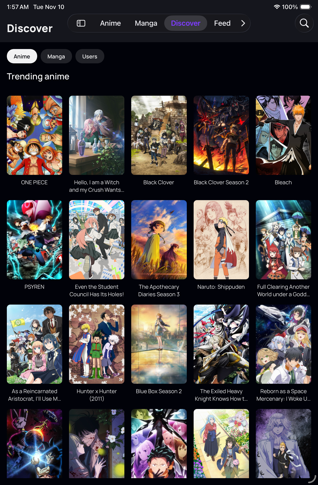
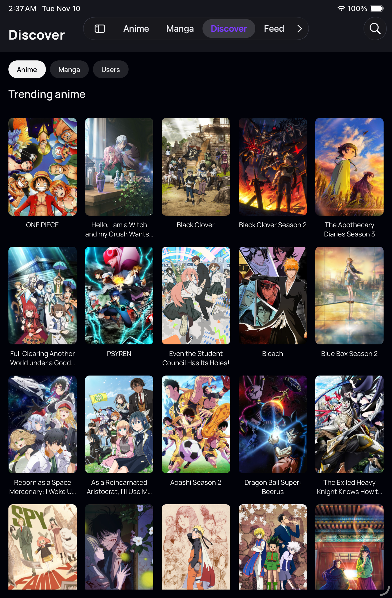
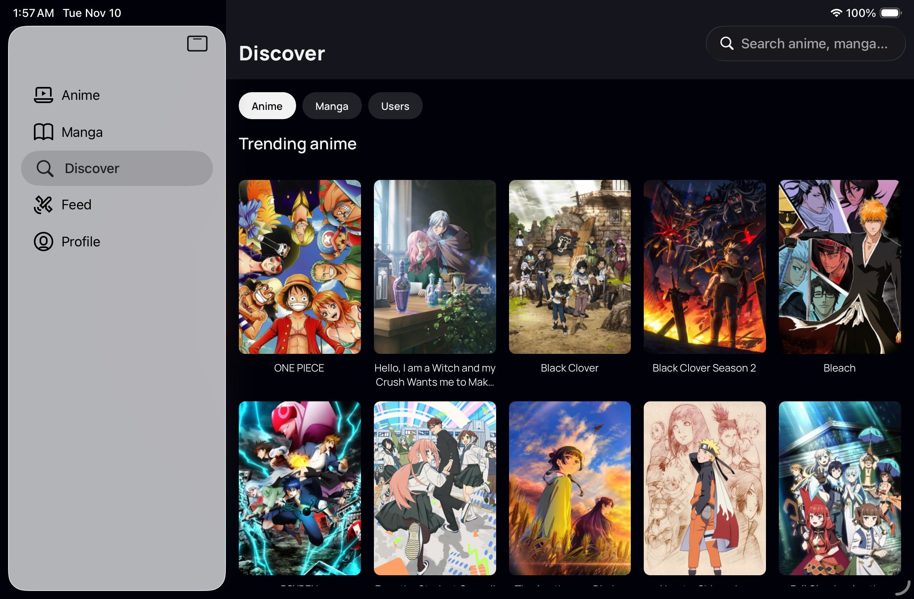
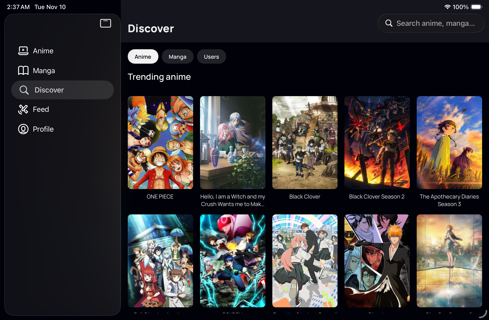
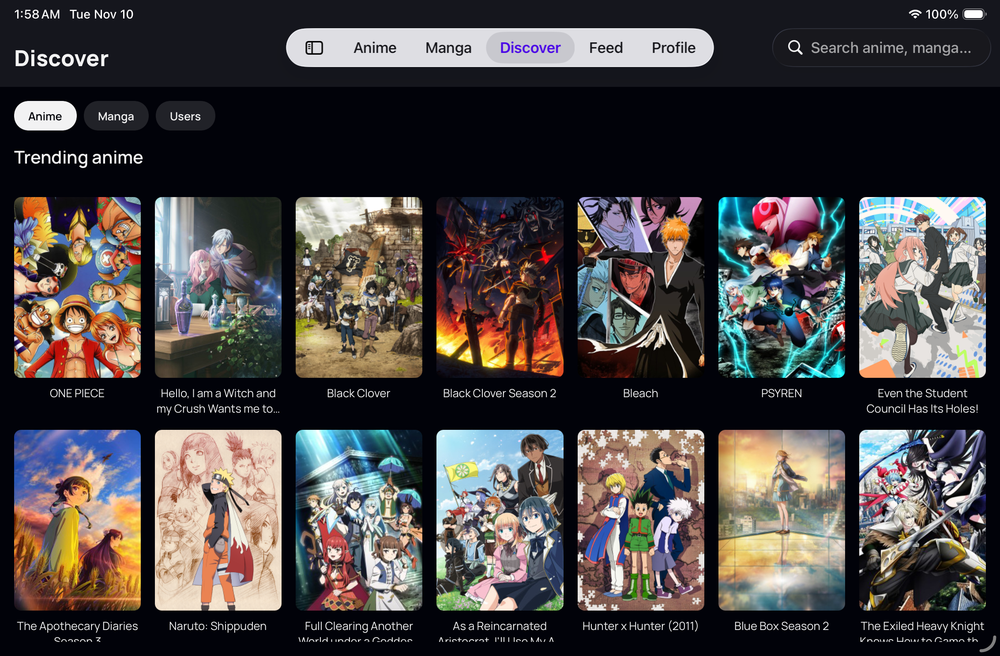
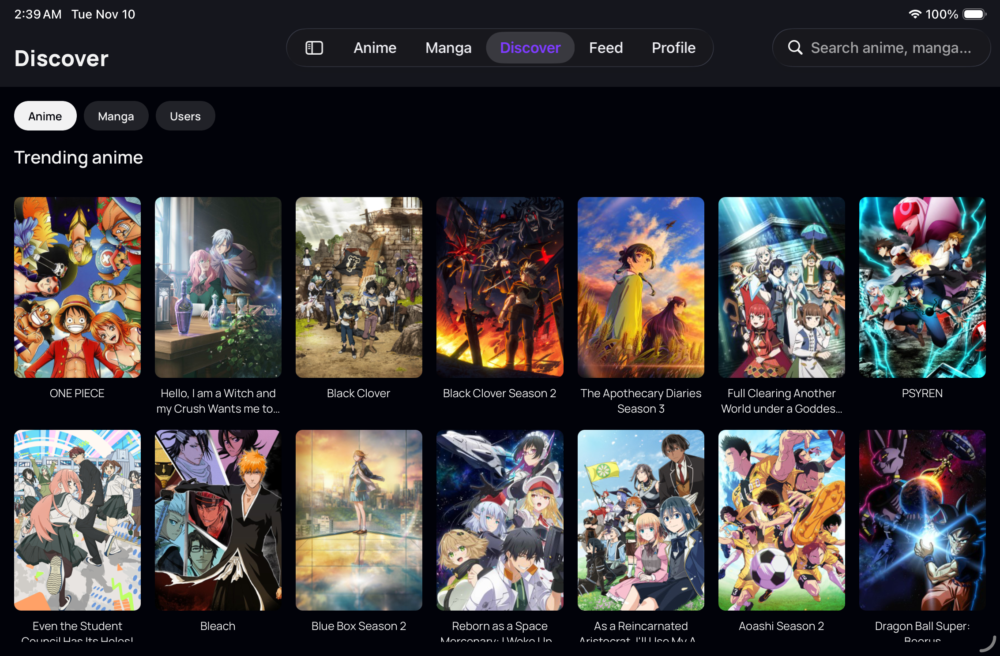

# Native navigation theme

Follow-up to [PR #89](https://github.com/FiberJW/goodweebs/pull/89). App source: `a078252`.

The app's screens use a fixed dark palette, but the native sidebar and top tab bar appeared light. Two settings were inconsistent with that palette:

- Without a Router `ThemeProvider`, native tab screen wrappers used the default light navigation background, including the surface behind Liquid Glass.
- The shared dark splash configuration made the splash plugin write `UIUserInterfaceStyle = Automatic`, overriding the existing iOS `userInterfaceStyle: "dark"` setting. The built client confirmed `Automatic` before the fix.

The root native navigator now uses `DarkTheme` with the existing Goodweebs background, navigation, text and purple accent colors. iOS uses its dark splash as its sole splash appearance, so prebuild retains `Dark`. Android's resolved light and dark splash configuration is unchanged. Native sidebar adaptation and system materials remain enabled.

## EAS visual proof

Five new captures came from [EAS iPad mini A17 Pro, iPadOS 26.5](https://expo.dev/accounts/fiberjw/projects/goodweebs/simulator-sessions/01a1c4ff-936b-7f09-b491-b6fa1fa06a4d), using the fresh native development client and this checkout's Metro tunnel. The device was explicitly set to Light, then Dark appearance. App-scoped native inspection confirmed Discover remained selected in all five captured states, including after hiding and reopening the sidebar.

The before views are the previously uploaded PR #89 captures, from the same device model and runtime, before this appearance fix. Live content order and clocks differ. These are unretouched PNGs; landscape orientation was exported upright by Argent. [The manifest](manifest.json) records source commits, dimensions and SHA-256 hashes. No pixel threshold comparison is claimed for the dynamic feed.

| State | Before | After, device in Light appearance |
| --- | --- | --- |
| Portrait |  |  |
| Landscape sidebar |  |  |
| Landscape top tabs |  |  |

| Device in Dark appearance: sidebar | Device in Dark appearance: top tabs |
| --- | --- |
|  |  |

The EAS session and task Metro process were stopped after capture; session credentials were cleared. Signed-in, other-screen, Dynamic Type, VoiceOver, keyboard, multitasking, and Duo acceptance were not rerun for this appearance patch. The broader audit's pending requirements still apply.

## Guidance

[Expo's native tabs guide](https://docs.expo.dev/router/advanced/native-tabs/#white-background-flashes-when-switching-tabs-on-ios-26) recommends a matching `ThemeProvider` for dark-only apps. On iOS 26, the material takes its appearance from the underlying content; the tab bar's background props are insufficient. [Apple's materials guidance](https://developer.apple.com/design/human-interface-guidelines/materials) describes native navigation materials adapting to the content beneath them. This patch preserves the app's existing dark-only design.

## Local checks

Actual output on the changed source:

```text
bun run typecheck
$ tsc --noEmit
(exit 0)

bun run lint:check
$ eslint . --ext .ts,.js,.tsx
(exit 0)

bun run gql:check
$ gql-tada check
✓ No problems found

bun test
27 pass
0 fail
88 expect() calls
```

After `APP_VARIANT=development npx expo prebuild --platform ios --no-install`, inspecting the generated plist gave:

```text
ios/GoodweebsDev/Info.plist: UIUserInterfaceStyle = Dark
```

Comparing the resolved Android splash configuration before/after using the installed splash plugin's `getAndroidSplashConfig` and `deepStrictEqual` gave:

```text
Android splash configuration: unchanged (light and dark)
```

The fresh Xcode 27.2 Debug simulator build completed with `** BUILD SUCCEEDED **`. Its built `GoodweebsDev.app/Info.plist` also reports `UIUserInterfaceStyle = Dark` and bundle ID `com.fiberjw.goodweebs.dev`.

## Verify yourself

Use a newly built client; Fast Refresh cannot change `UIUserInterfaceStyle` in an existing binary.

```sh
APP_VARIANT=development npx expo prebuild --platform ios --no-install
(cd ios && pod install)
xcodebuild -workspace ios/GoodweebsDev.xcworkspace -scheme GoodweebsDev \
  -configuration Debug -sdk iphonesimulator \
  -destination 'generic/platform=iOS Simulator' \
  -derivedDataPath /tmp/goodweebs-theme-derived CODE_SIGNING_ALLOWED=NO build
```

Install that development client in an EAS iPad mini session and connect it to this checkout's Metro tunnel. Choose **Continue without logging in → OK → Discover**. With the device set to Light appearance, check portrait, rotate to landscape, and use **Hide Sidebar** to return to the top tabs. Expect dark navigation surfaces, readable light labels, the existing purple selection, and Discover to remain selected. Repeat with the device in Dark appearance.
