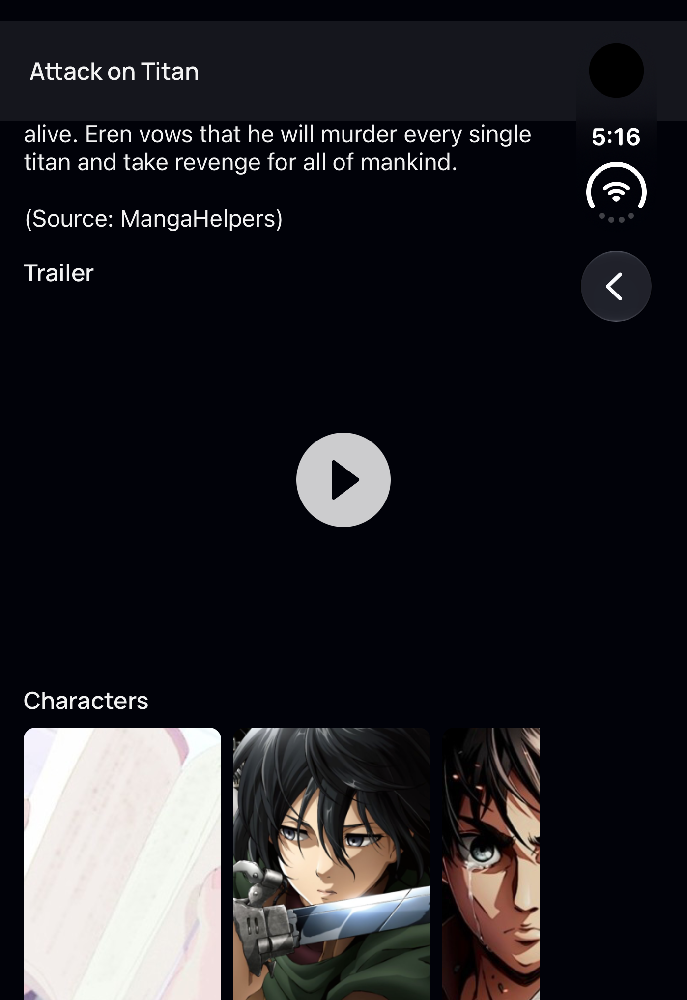
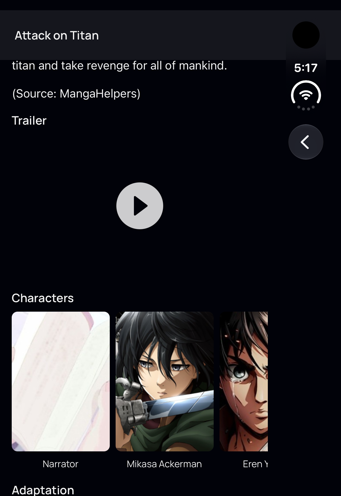

# Review fixes: trailer sizing and Profile background

Fresh remote EAS captures on iPhone Duo, iOS 27.1, cover panel, 1398 × 2034. [Session](https://expo.dev/accounts/fiberjw/projects/goodweebs/simulator-sessions/01a1c58d-9662-7fc0-9350-1bd41ead4a4f). Source and screenshot hashes are in [manifest.json](manifest.json).

## Trailer comparison

Attack on Titan (`/details/16498`), guest, same compatible native development client, separate Metro tunnels for baseline `8a8ad24` and fixed source `2210d6c`. The baseline sizes the trailer from the full window; the fix uses its inset content container and a 16:9 aspect ratio.

| Before | After |
| --- | --- |
|  |  |

The remote thumbnail did not load in either capture. These unmodified screenshots prove the play-button placement and trailer-area sizing, not successful thumbnail delivery or playback. Scroll offsets differ slightly.

## Profile verification limit

The shared `UserProfile` ScrollView now paints its viewport with `darkTheme.background`, matching its content. [Native runtime inspection](profile-viewport-runtime.json) confirmed an opaque `#010209` on the actual `RCTScrollViewComponentView` in the public-profile error branch. This is supporting runtime evidence for the shared component only.

**Signed-in Profile overscroll remains unverified.** The authorized dummy-account login page loaded and its security challenge succeeded, but submission did not advance to authorization or the app. Credential entry was kept out of saved screenshots and logs. No signed-in before/after capture or refresh recording is claimed.

## Checks

```text
bun run typecheck           exit 0
bun run lint:check          exit 0
bun run gql:check           ✓ No problems found
bun test                   25 pass, 0 fail, 40 expect() calls, 5 files
bunx prettier --check      All matched files use Prettier code style
git diff --check          exit 0
```

The earlier grid-only test file was removed because new test files require explicit approval. Existing tests remain unchanged. The formatting check covered Discover, Feed, MediaList, UserProfile and Trailer.

Added `.easignore` preserving all existing `.gitignore` patterns and excluding `docs/qa/`. [Archive inspection](archive-verification.txt) confirmed zero QA files, no simulator dotenv, and the fixed trailer source. Images remain available in GitHub evidence links without entering EAS build uploads.

## Reproduce

1. Start an authorized remote EAS Argent session following `CLAUDE.md`, install a compatible development client, and connect it to this checkout's Metro tunnel.
2. Continue as guest, then open `goodweebs-dev://details/16498`. Scroll to Trailer. On the Duo cover panel, its play button should align with the centre of the content beside the system rail. Its area should stay 16:9 when the content width changes.
3. For the outstanding check, sign in to the dummy account, open Profile, and pull to refresh or bounce at either end. Expect the area behind the refresh control and exposed viewport to stay `#010209`, with no gray strip. Repeat on iPad mini.
4. Run `bun run typecheck`, `bun run lint:check`, `bun run gql:check` and `bun test`; expect exit 0 and 25 passing tests.
5. Run `CI=1 npx --yes eas-cli@latest build:inspect --platform ios --profile development --stage archive --output /tmp/goodweebs-archive-check`. Expect no files under `docs/qa` and no `.env.eas-simulator` in the archive.

The EAS session and both task-owned Metros were stopped; simulator credentials were cleared. No new iPad, signed-in, keyboard or accessibility acceptance is claimed by this follow-up; earlier iPad evidence remains in the parent audit.
