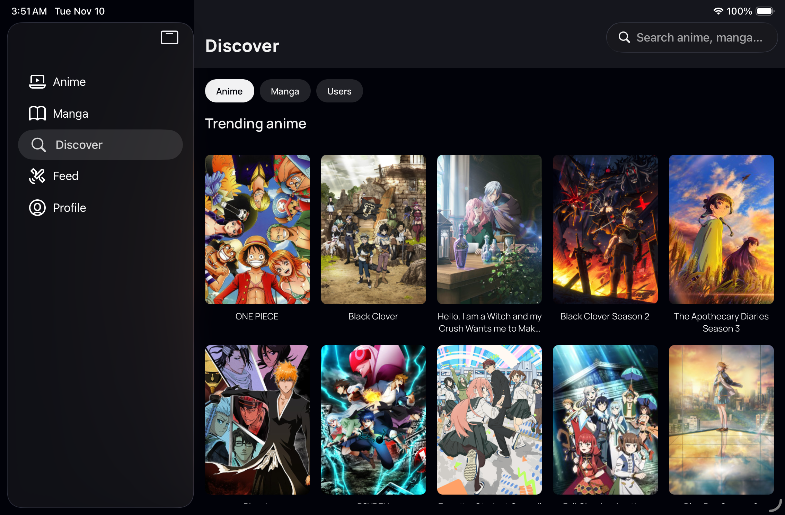
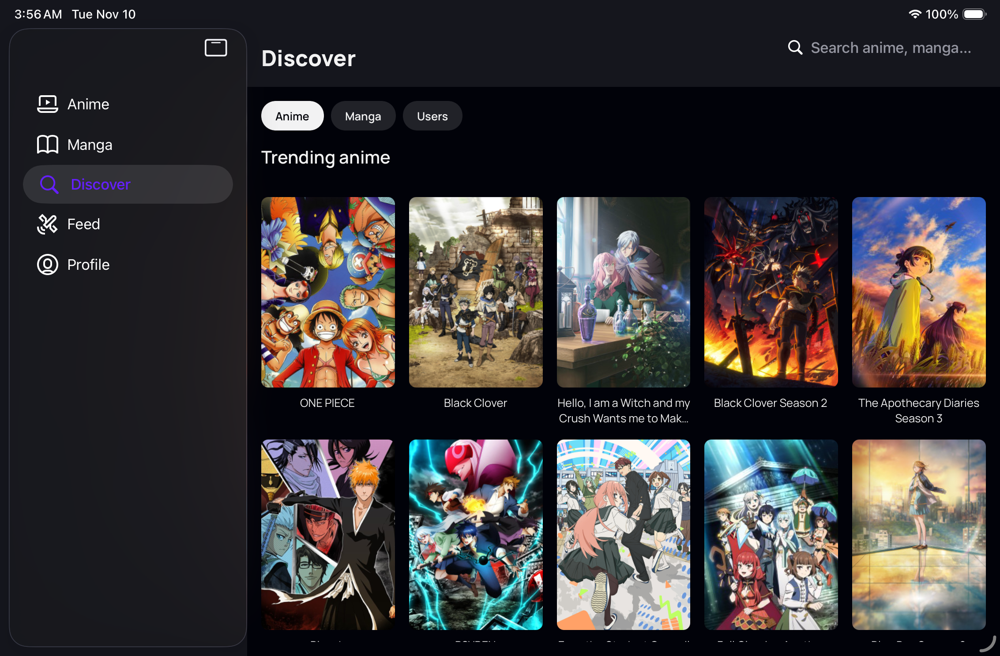
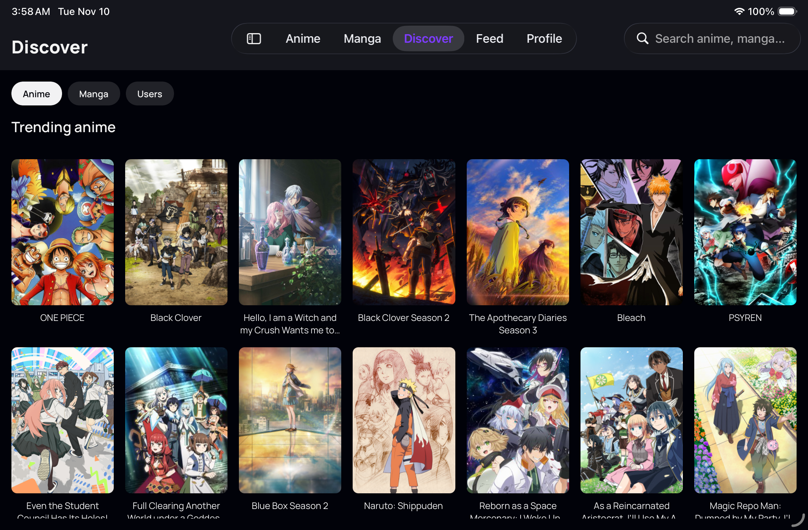
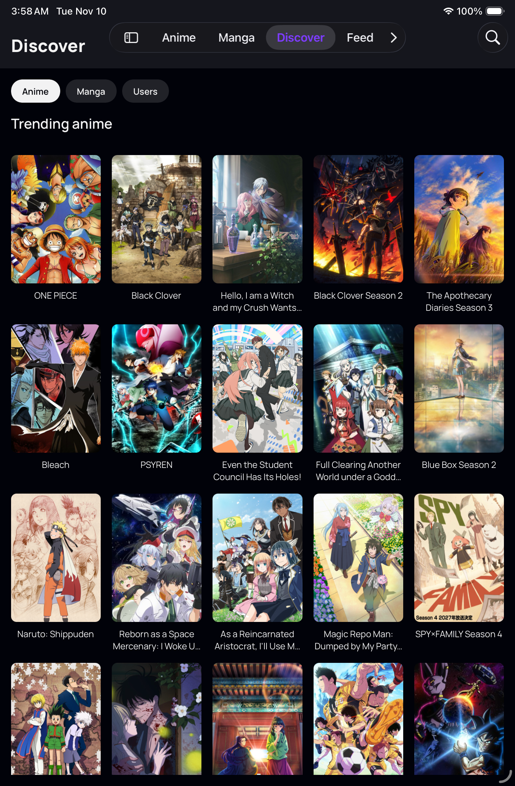
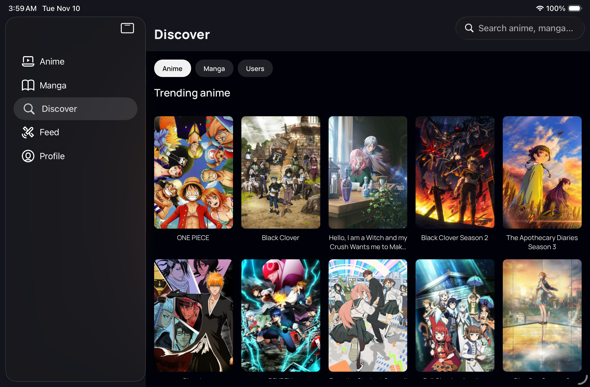
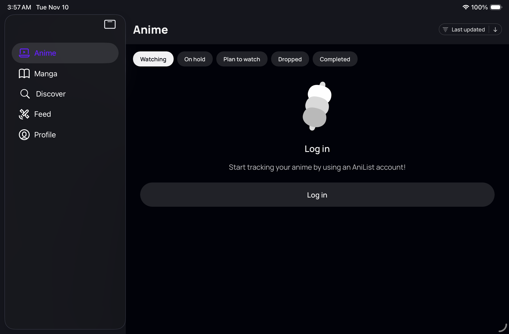
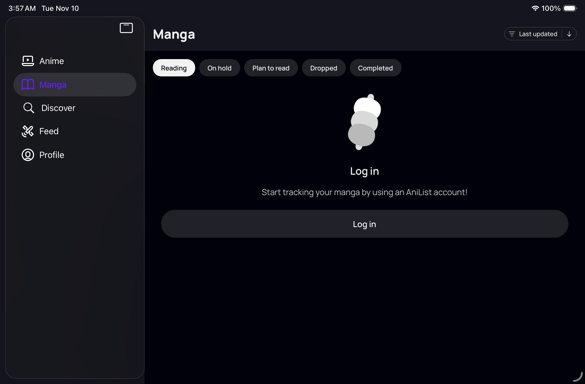
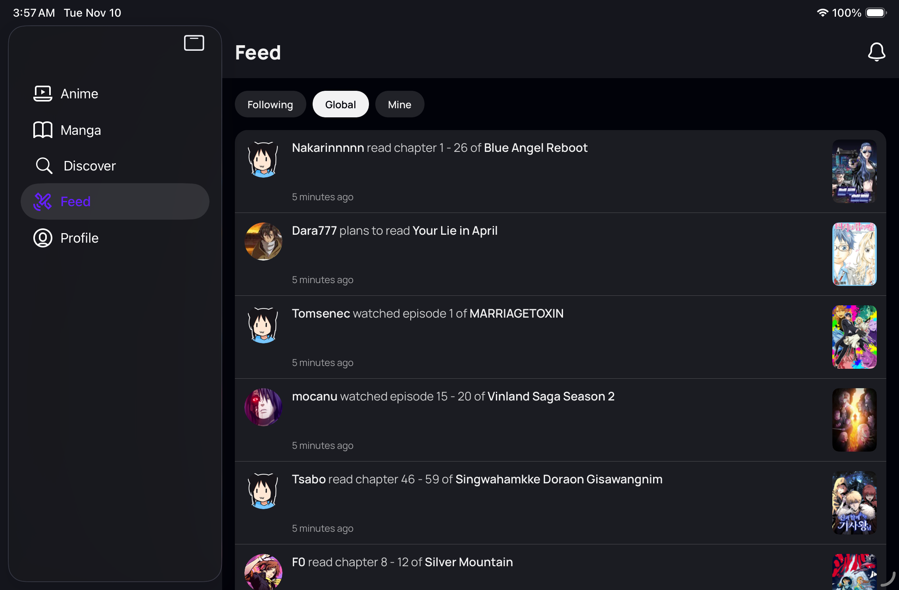
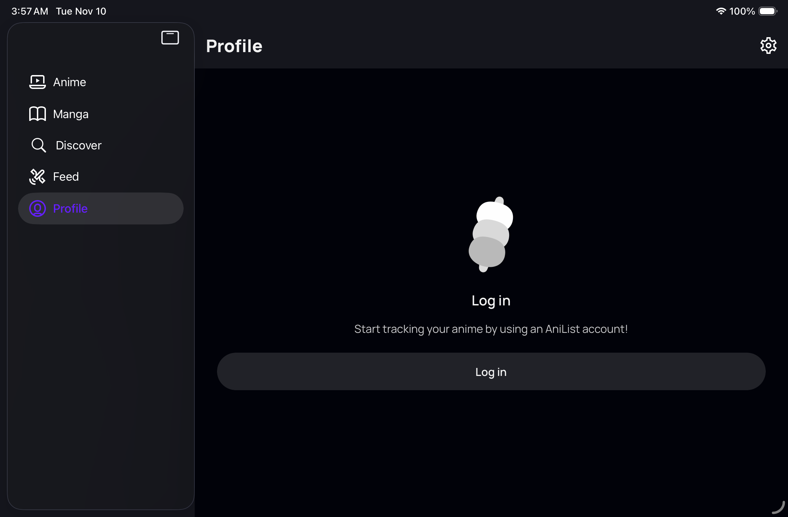

# Sidebar background continuity

App source `555002c`, compared with PR #89's preceding head `05e5850`. Captured in [one EAS iPad mini A17 Pro session, iPadOS 26.5](https://expo.dev/accounts/fiberjw/projects/goodweebs/simulator-sessions/01a1c548-4ad9-72ee-9086-dd24c0cffb51).

On the tested iPadOS 26.5 runtime, the native sidebar floats below the status bar. The visual seam came from each tab's full-window safe-area view: its black background extended behind the sidebar, while the header beside it was dark gray. The tab safe-area canvases now use the header's `navBackground`. Content views and lists retain the original black background. This covers Anime/Manga, Discover, Feed and Profile, including their guest states. Native sidebar geometry and safe-area padding are unchanged.

Apple describes the iPadOS 26 inset sidebar in [Get to know the new design system](https://developer.apple.com/videos/play/wwdc2025/356/). iPadOS 27 changes native sidebars to extend to the window edges, as explained in the [WWDC26 State of the Union](https://developer.apple.com/videos/play/wwdc2026/102/). This gallery is 26.5 compatibility evidence; it does not establish the current iPadOS 27 container or button appearance.

## Before and after

Same simulator and development client, with matching source served through the task Metro tunnel on port 8098. The client is the previously verified Xcode 27.2 Debug build with `UIUserInterfaceStyle = Dark`; this JavaScript-only follow-up changes no native configuration or dependencies. PNGs are unretouched. Landscape was exported upright in its corresponding orientation by Argent. Live data, clock and selection tint can vary.

| Before, device in Light appearance | After, device in Light appearance |
| --- | --- |
|  |  |

| Landscape top tabs | Portrait | Device in Dark appearance, opposite landscape direction |
| --- | --- | --- |
|  |  |  |

| Anime guest | Manga guest |
| --- | --- |
|  |  |

| Global Feed as guest | Profile guest |
| --- | --- |
|  |  |

## Verification

Native accessibility inspection confirmed the selected destination after navigating to all five sidebar items. Discover stayed selected after hiding the sidebar, rotating to portrait, rotating to the other landscape direction and reopening the sidebar. All eight after captures passed sampled-background assertions. [The manifest](manifest.json) records source commits, dimensions, hashes and the pixel samples.

Actual RGB samples from full-resolution landscape PNGs:

| Sample | Before | After |
| --- | --- | --- |
| Status-bar area above sidebar, `(500, 10)` | `(1, 2, 9)` | `(21, 22, 29)` |
| Main header/status background, `(900, 10)` | `(21, 22, 29)` | `(21, 22, 29)` |
| Content background, `(2200, 300)` | `(1, 2, 9)` | `(1, 2, 9)` |

The flat background samples avoid text and controls. The native glass shadow slightly darkens the narrow outer sidebar margin; no full-frame pixel regression result is claimed for the live feed.

Commands and actual output on the final app source:

```text
bun run typecheck
$ tsc --noEmit
(exit 0)

bun run lint:check
$ eslint . --ext .ts,.js,.tsx
(exit 0)

bun test
27 pass
0 fail
88 expect() calls

Rendered PNG assertions
PASS: all 8 after captures match expected header/status/body colors; before shows mismatch
```

The task EAS session and Metro process were stopped, and session credentials cleared. Signed-in states, accessibility, Duo and Android were not rerun for this background follow-up; the broader audit remains incomplete.

## Verify yourself

Use a compatible development client with this checkout's Metro bundle. From **Continue without logging in → OK → Discover**, rotate the iPad mini to landscape. Expect a continuous dark-gray surface across the status bar and behind the sidebar, with the content area still black. Switch through all five sidebar destinations, choose **Hide Sidebar**, rotate to portrait and back, then reopen the sidebar. Repeat with the device in Dark appearance. The sidebar should retain its native floating inset, and Discover should remain selected through the orientation and sidebar changes.
